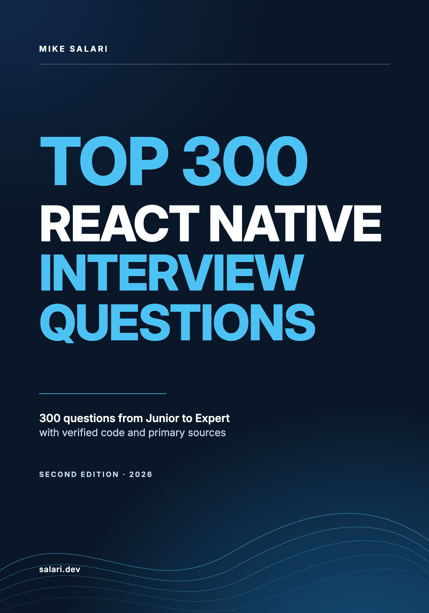

# Most candidates know the answer. Strong candidates know what comes next.

**A free sample of *Top 300 React Native Interview Questions and Answers* (Second Edition).**

By **Mike Salari** · [salari.dev](https://salari.dev)

[**Read on desktop**](Top-300-React-Native-Interview-Questions-sample-desktop.pdf) · [**Read on your phone**](Top-300-React-Native-Interview-Questions-sample-mobile.pdf) · [**Get the full book**](https://mikesalari.gumroad.com/l/top-react-native-interview-questions?utm_source=github&utm_medium=sample&utm_campaign=rn_second_edition_2026)

---

## The answer is right. The interview isn't over.

An interviewer asks how you prevent memory leaks in effects. You say: return a cleanup that removes the listener, clears the timer, aborts the request. Correct.

Then comes the follow-up. A profile screen fetches a user when `userId` changes. The user taps through three profiles, and the response for the first one arrives last. What does the screen show?

The late response for the first profile can overwrite the data of the profile the user is now looking at. A candidate who only knows the textbook answer has nowhere to go from here. This sample shows what the next answer sounds like.

## What's inside

- **The method.** Five parts for every answer: the answer, production depth, a common pitfall, what the interviewer is testing, and further reading.
- **A weak answer next to a strong one.** The same question (Question 87), so you can see what the second answer adds.
- **One complete senior answer.** Question 170, planning a migration from the old architecture, with its sources.
- **What the full book covers.** Six levels, from junior to expert, and what each one trains.

The scenario above is a teaching case written for this sample. It is not an account of a real interview.

## Pick your screen

| Edition | Best for | Pages | Open |
| --- | --- | ---: | --- |
| **Desktop** | Laptop, large screen, print | 7 | [Desktop PDF](Top-300-React-Native-Interview-Questions-sample-desktop.pdf) |
| **Mobile** | Reading on a phone, no zooming | 8 | [Mobile PDF](Top-300-React-Native-Interview-Questions-sample-mobile.pdf) |

Same content, two layouts. Free, no email, no sign-up.

## The full book

*Top 300 React Native Interview Questions and Answers* has 300 questions in six levels (Junior, Junior to mid, Mid, Senior, Staff, Expert), 403 pages, in PDF and EPUB. Every answer has the same five parts. It is written against React Native 0.88, React 19.3, Expo SDK 58 and TypeScript 6.0.3.

| Edition | What you get | Price |
| --- | --- | ---: |
| **Book** | PDF and EPUB. 300 questions, 99 type-checked TypeScript examples across 95 questions, 62 decision tables, a night-before chapter and three study routes | $79 |

**[Get it on Gumroad](https://mikesalari.gumroad.com/l/top-react-native-interview-questions?utm_source=github&utm_medium=sample&utm_campaign=rn_second_edition_2026)**

## Who it's for

JavaScript and TypeScript developers moving into React Native, mid-level engineers who know the APIs and lose the room on why, and senior and staff candidates preparing for architecture, performance and reliability rounds. It is not a tutorial, it assumes you can read TypeScript and function components, and it is not a guarantee of an outcome.

## About the author

**Mike Salari** is a Staff mobile engineer. 15+ years across Apple, Adobe, Cisco, Visa, Mastercard and Deloitte, and 500+ technical interviews from the hiring side. He writes about software engineering and careers at [salari.dev](https://salari.dev).

[Website](https://salari.dev) · [LinkedIn](https://www.linkedin.com/in/mike-salari/)

## Sharing and copyright

© 2026 Mike Salari. All rights reserved.

Share the link to this repository freely. The PDFs are free to read for personal use. They are not licensed for redistribution, adaptation or commercial use. For anything beyond reading, ask the author first. React Native and the React logo are trademarks of their respective owners. This independent publication is not affiliated with or endorsed by Meta.
